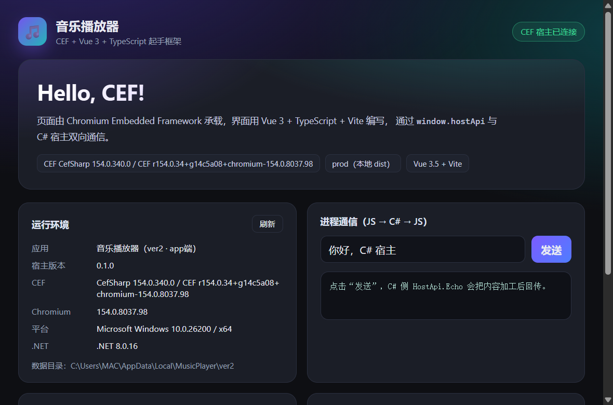
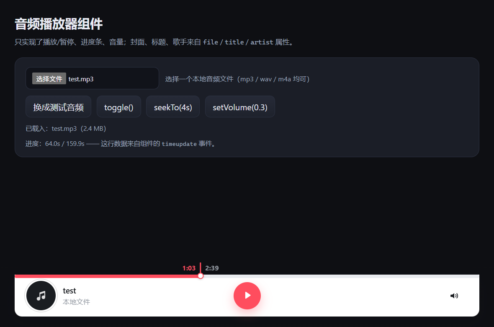
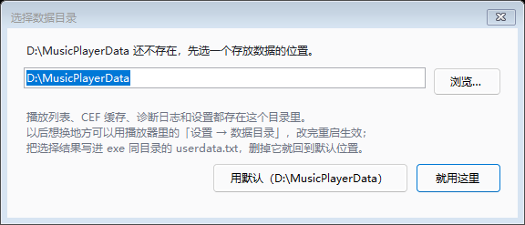
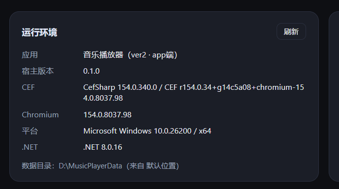
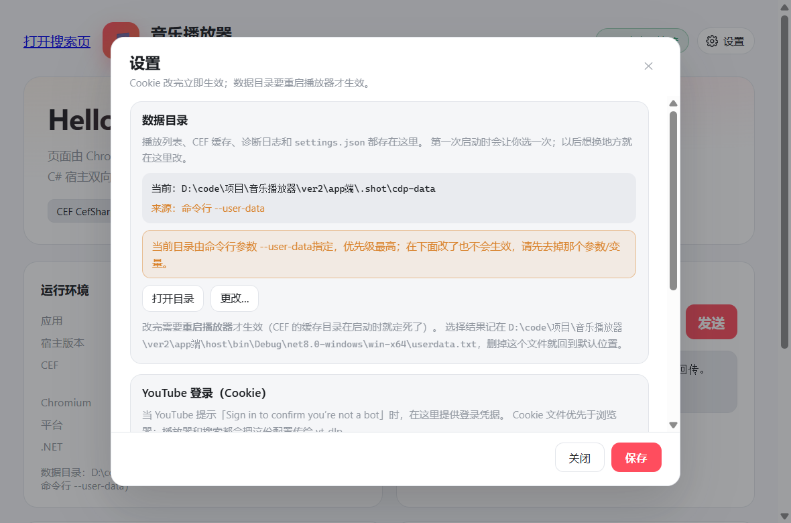

# 音乐播放器 · app端（CEF + TypeScript + Vue 3）

一句话：**CEF 内核（CefSharp 154 / Chromium 154）当容器，Vue 3 + TypeScript + Vite 写界面，C# WinForms 做宿主窗口和本地能力。**



## 目录结构

```
app端/
├─ renderer/                    # 前端：Vue 3 + TS + Vite
│  ├─ index.html               # 带 CSP
│  ├─ vite.config.ts           # base:'./'，为自定义协议/相对路径准备
│  └─ src/
│     ├─ main.ts               # 挂载前先完成宿主对象绑定
│     ├─ App.vue
│     ├─ router/index.ts       # hash 路由（app:// 与 file:// 下都可靠）
│     ├─ stores/app.ts         # Pinia 示例 store
│     ├─ stores/playlist.ts    # 多播放列表仓库（核心 + 列表库 + 导入导出）
│     ├─ stores/settings.ts    # 设置面板状态
│     ├─ playlist/             # 播放核心 / 列表库 / 存档 / 播放适配
│     ├─ search/               # ★ 站点注册表：sourceKeys.ts / sources.ts / modes.ts / hostSources.ts
│     ├─ components/PlaylistBar.vue    # 列表栏（切换 / 新建 / 重命名 / 删除 / 导入 / 导出）
│     ├─ components/SettingsDialog.vue # ★ 设置面板（YouTube Cookie）
│     ├─ bridge/host.ts        # ★ 前端 ↔ C# 桥（类型 + 降级）
│     └─ views/HomeView.vue    # Hello World 演示页
├─ host/                       # 宿主：C# / WinForms / CefSharp
│  ├─ Program.cs               # CEF 初始化、自定义 app:// 协议注册
│  ├─ MainForm.cs              # 主窗口 + 注册 hostApi
│  ├─ HostApi.cs               # ★ 暴露给 JS 的 C# 方法
│  ├─ Settings.cs              # ★ settings.json 读写、Cookie 文件体检
│  ├─ DataLocation.cs          # ★ 数据目录解析（userdata.txt / portable.txt / 默认 / 兜底）
│  ├─ DataDirectoryDialog.cs   # ★ 首次启动「选择数据目录」对话框
│  ├─ BundledTools.cs          # ★ ffmpeg / yt-dlp 的查找顺序（便携包 bin\）
│  ├─ WebTarget.cs             # dev server / 本地 dist 的选择逻辑
│  ├─ StartupOptions.cs        # --dev / --url / --web-root
│  └─ app.manifest             # PerMonitorV2 DPI
├─ tools/make-package.ps1      # ★ 一键产出自包含便携包（dist/ + ZIP）
├─ package.json                # 一键脚本
└─ pnpm-workspace.yaml
```

## 环境要求

- Windows 10/11 x64
- **.NET 8 SDK**（含 WindowsDesktop 运行时）
- **Node 20+ / pnpm 10**
- VC++ 2015–2022 运行时（CefSharp 依赖，一般机器已带）

CEF 二进制由 NuGet 包 `CefSharp.WinForms.NETCore` 自带（约 300MB），**不需要自己下载或编译 CEF，也不需要 Visual Studio / MSVC**。

> 上面是**开发机**的要求。只想把成品给别人用，看下一节，目标机器**不需要**装 .NET。

## 导出给别的电脑用（便携包）

一条命令：

```powershell
pnpm package        # = tools/make-package.ps1
```

它会依次做四件事：

1. `pnpm --filter renderer build` —— 构建前端；
2. `dotnet publish -c Release -r win-x64 --self-contained true` —— **自包含发布**，.NET 运行时和 CEF 一起进 `dist\`；
3. 把 `ffmpeg.exe` 拷进 `dist\bin\`（B站 AAC 音轨必须靠它实时转码），找到**独立版** `yt-dlp.exe` 也一并拷进去；
4. 写一份 `dist\使用说明.txt`，然后压缩成 `artifacts\music-player-<版本>-win-x64.zip`。

产物两份，二选一给人都行：

| 产物 | 用法 | 实测体积 |
| --- | --- | --- |
| `dist\` | 整个目录拷走（或在别的机器上直接运行），双击 `MusicPlayer.Host.exe` | 766 MB |
| `artifacts\music-player-<版本>-win-x64.zip` | 发给别人；资源管理器「全部解压缩」后双击 exe | 321 MB |

> 体积大头是 CEF（约 500 MB）和 ffmpeg full build（217 MB）。想瘦身见下方 `-FfmpegPath`。

常用参数：

```powershell
pwsh -File tools/make-package.ps1 -NoZip      # 只出 dist\，本地先验一遍
pwsh -File tools/make-package.ps1 -NoWebBuild # 前端已构建过，省掉一次
pwsh -File tools/make-package.ps1 -NoFfmpeg   # 不打 ffmpeg（包小一点，B站 AAC 播不了）
pwsh -File tools/make-package.ps1 -FfmpegPath D:\ffmpeg-essentials\ffmpeg.exe  # 换精简 ffmpeg
```

`ffmpeg` 只需要 **AAC 解码 + WAV 输出**，装 `ffmpeg-release-essentials` 一类的精简构建就够，体积能小一半以上。

**目标机器要求**（包里已含 .NET 运行时，只有两条）：

- Windows 10 / 11 x64；
- VC++ 2015–2022 可再发行组件 x64（CefSharp 依赖，绝大多数机器已有；缺了会提示 `vcruntime140.dll`，装 [vc_redist.x64.exe](https://aka.ms/vs/17/release/vc_redist.x64.exe) 即可）。

**外部工具怎么被找到**（`host/BundledTools.cs`）——按顺序命中：

1. 环境变量 `MUSICPLAYER_FFMPEG` / `MUSICPLAYER_YTDLP`；
2. exe 同目录；
3. exe 同目录的 `bin\`；
4. `PATH`；
5. 安装位置兜底（WinGet 的 `Gyan.FFmpeg*`、`%APPDATA%\Python\Python313\Scripts`、`python -m yt_dlp`）。

所以给别人的包只要把 `ffmpeg.exe` / `yt-dlp.exe` 丢进 exe 旁边或 `bin\` 就行，**不用改 PATH、不用重启**。

| 依赖 | 是否内置 | 不装的后果 |
| --- | --- | --- |
| `ffmpeg` | 自动带上（本机找得到时） | B站音轨（AAC）无法转码，播不了 |
| `yt-dlp` | 只认独立 exe（≥ 2 MB），本机没装就不内置 | YouTube 搜索 / 播放不可用，B站不受影响 |
| .NET 8 桌面运行时 | 已随包（自包含发布） | — |

> **yt-dlp 有个坑**：`pip install --user` 装出来的 `%APPDATA%\Python\Python313\Scripts\yt-dlp.exe` 只有 0.1 MB，是个「启动垫片」——它靠本机 Python 跑 `yt_dlp` 模块，打进包里到没装 Python 的机器上直接不能用。脚本已经按体积把它过滤掉了；要内置就用独立 exe 版（约 17 MB）：
>
> ```powershell
> Invoke-WebRequest https://github.com/yt-dlp/yt-dlp/releases/latest/download/yt-dlp.exe -OutFile dist\bin\yt-dlp.exe
> ```
>
> 或者干脆不内置，让使用者自己丢进 `bin\`；`dist\使用说明.txt` 里已经把这条写好了。

**别忘了这几件事**：

- 不能只把 exe 拷走：`web\`（前端产物）、`libcef.dll`、`CefSharp.BrowserSubprocess.exe`、`locales\` 等必须跟 exe 同目录。
- 别放在 `C:\Program Files` 之类无写权限的目录：程序目录没写权限时连 `userdata.txt` 都存不下。
- **第一次启动会让使用者选数据目录**（默认 `D:\MusicPlayerData`），选择记在 exe 同目录的 `userdata.txt`；整个文件夹拷走时这个选择跟着走，到了新机器如果那个盘没有，会自动重新弹框。没有 D 盘又不选的话回退 `%LOCALAPPDATA%\MusicPlayer\ver2`。
- 想要「整个文件夹拷进 U 盘就走」的纯便携模式：在 exe 同目录放一个空文件 `portable.txt`，数据会落在该目录的 `data\`（详见「数据目录」一节）。
- 打包后建议在**没装 SDK 的机器**上双击验一次：首页能出、能播本地文件、B站能播（有 ffmpeg 时）。
- 还想要 `setup.exe` 安装包（开始菜单 / 卸载项）？本仓库暂未做，`dist\` 可直接喂给 Inno Setup 或 WiX 生成。

> 2026-11-01 实测：`pnpm package` 跑通，`dist\MusicPlayer.Host.exe --user-data <可写目录>` 能正常出窗口、CEF profile 与 `logs\` 都自动建好。注意**数据目录必须可写**，不可写时启动会直接弹「无法创建数据目录 / 数据目录不可写」并退出，此时用 `--user-data` 指到可写位置。

## 常用命令

| 命令 | 作用 |
| --- | --- |
| `pnpm install` | 装前端依赖（宿主依赖由 `dotnet restore` 自动拉取） |
| `pnpm dev` | 同时起 Vite + CEF 宿主，改前端代码立即热更新 |
| `pnpm dev:web` | 只起 Vite，用浏览器预览页面（此时 `hostApi` 走降级模拟值） |
| `pnpm build` | 打包前端 + 编译宿主（Release） |
| `pnpm start` | 直接跑宿主，加载本地 `renderer/dist`，不需要 dev server |
| `pnpm package` | ★ 产出**便携包**（见下节）：`dist\` + `artifacts\music-player-<版本>-win-x64.zip`，自带 .NET 运行时 |
| `pnpm package:fast` | 旧行为：只发布到 `dist\`，依赖目标机器已装 .NET 8 桌面运行时 |
| `pnpm typecheck` | 只做 Vue/TS 类型检查 |
| `pnpm clean` | 清理构建产物 |

## 页面是怎么被加载的

宿主有两种加载方式，由 `host/WebTarget.cs` 决定：

1. **dev**：`--dev` 且 `http://127.0.0.1:5173` 可访问 → 直接打开 Vite dev server，热更新可用；同时在 dev 模式开放 `9222` 远程调试端口（Chrome 打开 `chrome://inspect` 可连）。9222 常被本机 Chrome 占用，被占用时宿主会自动关闭该端口，可用 `--debug-port <端口>` 换一个（如 `--debug-port 9333`）。
   - 走代理时加 `--proxy http://127.0.0.1:7897`：CEF 会用这个代理，并自动 bypass `127.0.0.1`/`localhost`（不影响 `app://`、dev server 和 `stream://` 本地文件）。不传时 CEF 用系统代理，yt-dlp 会自动从注册表读同一个代理。
2. **prod**：通过自定义标准协议 **`app://web/index.html`** 读取 `renderer/dist`（`FolderSchemeHandlerFactory`）。

> 为什么不用 `file://`？`file://` 下 ES module 会被 CORS 拦截，页面会白屏。自定义协议既解决这个问题，又能拿到 secure context，后续加本地媒体协议也照这个套路。

查找顺序：`--url` → dev server → 输出目录 `web/` → 从输出目录向上找仓库里的 `renderer/dist` → 当前工作目录。

## 前后端通信（核心）

CefSharp 154 起绑定是**异步**的，必须显式绑定，且方法返回 Promise：

```csharp
// host/MainForm.cs
_browser.JavascriptObjectRepository.Register("hostApi", new HostApi(this), BindingOptions.DefaultBinder);
```

```ts
// renderer/src/bridge/host.ts
await CefSharp.BindObjectAsync('hostApi')   // 之后 window.hostApi 才存在
const raw = await window.hostApi.getHostInfo()
```

约定：

- 方法名自动 PascalCase → camelCase：`GetHostInfo` → `getHostInfo`。
- 复杂结构统一返回 JSON 字符串，前端 `JSON.parse`，避免跨进程类型映射的坑。
- 浏览器里（`pnpm dev:web`）没有宿主，桥接层自动降级成模拟值，页面照常开发。
- UI 相关调用必须切到 WinForms 线程（`HostApi.OnUiThread`）。

已有方法：`getHostInfo` / `echo` / `minimize` / `toggleMaximize` / `closeWindow` / `openDevTools` / `setZoomLevel` / `openUserDataFolder` / `openLogFolder` / `recordPlaybackLog` / `registerStream` / `searchMedia` / `getVideoInfo` / `resolveMedia` / `openExternalUrl` / `getSettings` / `pickYouTubeCookiesFile` / `checkCookiesFile` / `saveSettings` / `getDataDirectory` / `chooseDataDirectory` / `exportPlaylists` / `importPlaylists`。

### 新增一个宿主能力

1. `host/HostApi.cs` 加一个 `public` 方法（改 UI 的用 `OnUiThread` 封送）。
2. `renderer/src/bridge/host.ts`：在 `CefHostApi` 接口里加同名 camelCase 方法，并在 `host` 对象上加一层 Promise 包装。
3. 页面里 `await host.xxx()`。

### 新增一个页面

在 `renderer/src/views/` 新建 `XxxView.vue`，然后到 `renderer/src/router/index.ts` 的 `routes` 里注册即可（**保持 hash 路由**，`app://` 与 `file://` 下都可靠）。

## 音频播放器组件（`AudioPlayer.vue`）

[`renderer/src/components/AudioPlayer.vue`](renderer/src/components/AudioPlayer.vue)：按设计稿做的播放条，只实现**播放/暂停、进度条、音量**三件事；封面/标题/歌手只是展示属性。



演示页在 `/player`（`PlayerView.vue`）：可以选本地文件，也可以一键生成测试音频。

```vue
<script setup lang="ts">
import { ref } from 'vue'
import AudioPlayer from '@/components/AudioPlayer.vue'

const file = ref<File | null>(null)

function onPick(event: Event) {
  const input = event.target as HTMLInputElement
  file.value = input.files?.[0] ?? null
}
</script>

<template>
  <input type="file" accept="audio/*,.mp3" @change="onPick" />
  <AudioPlayer :file="file" :default-volume="0.8" @ended="下一首" />
</template>
```

| Props | 类型 | 说明 |
| --- | --- | --- |
| `file` | `File \| null` | 本地选中的音频，优先于 `src`；内部 `createObjectURL`，卸载时自动释放 |
| `src` | `string` | 音频地址（`app://` / `blob:` / `http(s)` 都行） |
| `title` / `artist` | `string` | 不传时标题取文件名、副标题显示「本地文件」 |
| `cover` | `string` | 封面图；不传显示音符占位 |
| `defaultVolume` | `number` | 初始音量 0~1，默认 0.8 |
| `autoplay` | `boolean` | 元数据就绪后自动播放 |

| 事件 | 参数 | 说明 |
| --- | --- | --- |
| `play` / `pause` / `ended` | — | 播放状态变化 |
| `loaded` | `duration` | 元数据加载完成 |
| `timeupdate` | `currentTime, duration` | 进度变化（约 4 次/秒） |
| `error` | `message` | 解码/加载失败 |

对外方法（通过 `ref` 调用）：`play()`、`pause()`、`toggle()`、`seekTo(seconds)`、`setVolume(0~1)`、`toggleMute()`。

全站配色只走 [`renderer/src/styles/main.css`](renderer/src/styles/main.css) 里的 `--mp-*` 令牌：**组件里不允许再写死色值**，也不再保留 `--bg` / `--panel` / `--accent` 这类旧变量。默认是浅色（白底 + 主题红），换主题只在 `:root` 覆盖变量：

```css
:root {
  --mp-page: #0e0f13;   /* 页面底色 */
  --mp-bg: #1b1e27;     /* 卡片 / 面板底色 */
  --mp-text: #e8eaf2;
  --mp-dim: #9aa3b8;
  --mp-track: #2b3040;
  --mp-border: #343a4b;
}
```

| 令牌 | 作用 |
| --- | --- |
| `--mp-page` / `--mp-bg` / `--mp-panel` | 页面底色 / 卡片面 / 面板（= `--mp-bg`） |
| `--mp-text` / `--mp-dim` / `--mp-on-accent` | 主文字 / 次要文字 / 主题色底上的文字 |
| `--mp-accent` | 主题红：强调、进度、选中、链接都用它 |
| `--mp-track` / `--mp-border` | 轨道、弱背景块 / 描边、分隔线 |
| `--mp-ok` / `--mp-warn` / `--mp-danger` | 成功 / 警告 / 错误状态 |
| `--mp-hover` / `--mp-accent-soft` / `--mp-accent-ring` / `--mp-accent-glow` | 悬浮底色 / 主题色浅底、光圈、投影 |
| `--mp-scrim` / `--mp-shadow-sm` / `--mp-shadow` / `--mp-shadow-lg` | 底部渐隐遮罩 / 三档阴影 |

进度线**紧贴卡片上沿**（顶部两角是直角，没有白边）。已播放段是实心主题红，未播放段是灰色轨道（`--mp-track`）。

**接触时**（hover / 拖动 / 键盘聚焦）圆点上方会浮出一个**垂直于进度条的红色竖标**，竖标两侧是时间：左边红色数字 = 已播放时长、右边灰色数字 = 总时长（13px 粗体）。竖标与圆点严格同心（实测中心 x 完全一致），整组跟着圆点移动；贴近两端时按实测宽度整体夹紧，既不会溢出，也不会两个标签互相压住。

几何都能只用变量调（覆盖在 `.mp-player` 上）：

| 变量 | 默认 | 作用 |
| --- | --- | --- |
| `--mp-track-h` | `5px` | 进度线粗细（hover 用 `scaleY` 变粗，不改布局高度，圆点不跳） |
| `--mp-thumb-size` | `12px` | 圆点直径 |
| `--mp-progress-hit` | `20px` | 点击/拖拽热区高度（只管手感，不影响视觉） |
| `--mp-tick-w` | `2px` | 圆点上方红色竖标的粗细 |
| `--mp-tick-h` | `23px` | 圆点上方红色竖标的长度（调大只会向上变长，不影响布局） |

> 竖标的长度是**阈值切换**，不做连续渐变：
>
> - 点与竖线相距 ≤ 阈值（默认约 7px，即脱开程度 < 0.2）→ **全长**；
> - 超过阈值（已经脱开）→ **固定的短**（约为 `--mp-tick-h` 的 40%）；
> - 跨过阈值的那一下由 `transition: height .18s` 播放成动画，中间不会出现任何中间长度；
> - 颜色：**左侧已播放数字**恒为主题红（左端竖标会从灰渐变回红）；**右侧总时长数字**的颜色随整首歌的播放进度**从灰渐变到红**（`color-mix` 按播放百分比混合，配 `transition: color .25s linear`），放到结尾时两边都是红色。

例：想把竖标做得更醒目：

```vue
<AudioPlayer :file="file" style="--mp-tick-h: 26px; --mp-tick-w: 3px" />
```

想让时间**常显**（不只在接触时）就把这段删掉或改成 `opacity: 1`：

```css
/* AudioPlayer.vue 里 .mp-time-group 默认 opacity: 0 */
.mp-time-group { opacity: 1; }
```

**进度交互**：整条进度线都可点、可拖（热区 20px 高），拖动时边拖边听；键盘支持 `←/→`（±5s，Shift ±15s）、`Home/End`；圆点在 hover / 拖动 / 聚焦时才出现，避免平时干扰视觉。

**内核编解码实测**（CEF 154 / Chromium 154）：`mp3` ✅、`wav` ✅、`ogg/opus` ✅、`flac` ✅；`m4a` / `aac` ❌（`canPlayType` 返回空）—— 这是 CEF 官方构建不含 AAC 专有编解码器导致的，要支持 m4a 得换带 proprietary codecs 的 CEF 构建。

### 播放实现分层（`renderer/src/playback/`）

组件不再直接操作 `<audio>`，媒体能力被抽到控制器接口后面，接新的播放形态（HTTP 直链 / HLS / YouTube）时**只新增实现，不动 UI**：

```
renderer/src/playback/
├─ types.ts                    # PlaybackController / PlaybackSnapshot / PlaybackCapabilities
└─ mediaElementController.ts   # 基于 <audio> 的实现（本地文件 / HTTP 直链 / app://）
```

| 契约 | 说明 |
| --- | --- |
| `load({ file, url })` | `file` 优先（内部 `createObjectURL`，自动释放）；否则用 `url`（http/https/app:// 都行） |
| `play / pause / seek / setVolume / setMuted` | 统一操作入口 |
| `snapshot()` | 只读快照：`playing / loading / currentTime / duration / buffered / volume / muted / error` |
| `on(event, handler)` | `loaded / timeupdate / play / pause / ended / statechange / error`，返回取消订阅函数 |
| `capabilities` | `seek / duration / buffered / volume / audioData`，UI 按它降级（例如 iframe 实现 `buffered=false` 就不画缓冲条、live 流 `duration=false` 显示 LIVE） |

组件侧接线：`watch([file, src])` → `controller.load(...)`；controller 事件 → 同步到视图 refs 并转发 `emit`；卸载时退订 + `controller.dispose()`。

> 新增一种播放形态（以 HLS 为例）：实现同一个 `PlaybackController` 接口 → 用一个工厂按源的 `type` 选择实现即可，`AudioPlayer.vue` 的模板与样式完全不用改。

### 流式播放（HTTP 直链）

演示页 `/player` 里有一个「流式地址」输入框，填 `http(s)://…` 即可直接播（`file` 优先，所以切流式时会清空本地文件）。

已实现的部分：

| 能力 | 做法 |
| --- | --- |
| 二级进度条 | 已缓冲区间画在填充线下方一层（`--mp-buffered`，默认主题红 32% + 轨道色混合）；时长未知或实现不支持 `buffered` 时自动不画 |
| 缓冲高亮 | `loading` 为真时进度轨道上扫过一条高光（`waiting` / `loadstart` 置真，`canplay` / `playing` 置假；seek 不再误触发） |
| 元数据/错误 | `readyState / networkState / error.code` 直接显示在演示页，便于排流式问题 |
| CSP | `media-src` 与 `connect-src` 放开 `http://127.0.0.1:*`（本地流调试用） |

**实测结论（重要）**：

- **dev（页面 origin 是 `http://127.0.0.1:5173`）**：本地 http 直链播放完全正常 —— 时长解析 `159.9s`、`已缓冲区间 1 段`、seek 到 80% 精确命中 `128s`。
- **prod（页面 origin 是 `app://web`，属于 secure origin）**：加载 **`http://`** 媒体会被 Chromium 当**混合内容**处理 —— 请求会先被「自动升级成 https」再失败（CDP 里看到 `net::ERR_ABORTED`，服务端收不到请求），加 `--allow-running-insecure-content` 也救不回来。

所以 prod 下要播本地/自建流，有两条正路：

1. **媒体走 https**（正式 CDN 天然满足，当前实现直接可用）；
2. **宿主 `stream://` 代理**（已实现，见下节）。

### `stream://` 宿主代理（已实现）

宿主注册了一个 secure 的自定义协议 `stream://media/<id>`：页面只拿这个地址当 `src`，真正的 http(s) 请求由**宿主进程**发出，再把响应（含 206/Range）原样转给 CEF。这样既绕开混合内容限制，又能统一注入 `Referer` / `Authorization` / `Cookie` 等头。

```
页面                         宿主
─────────────────────────────────────────────────────
hostApi.registerStream(url, headersJson)
        │                        └─ 登记到内存表，返回 "stream://media/1"
        ▼
<audio src="stream://media/1">
        │                        ┌─ HttpClient 请求上游（转发 Range、注入自定义头）
        └────────────────────────┤   StreamProxyHandler 回写 206/200 + Content-Range
                                 └─ 分块 ReadResponse，内存占用与文件大小无关
```

宿主侧文件：[host/StreamProxy.cs](host/StreamProxy.cs)（注册表 + `IResourceHandler` 实现 + `ISchemeHandlerFactory`），协议在 [host/Program.cs](host/Program.cs) 里注册，JS 入口是 [host/HostApi.cs](host/HostApi.cs) 的 `RegisterStream`。

前端调用：

```ts
import { host } from '@/bridge/host'

const proxied = await host.registerStream('http://127.0.0.1:8787/audio1.mp3', {})
// -> "stream://media/1"，直接当 src 用
```

演示页 `/player` 里对应「走 stream:// 代理播放」按钮，原始 URL 会作为标题来源。

**实测（prod，页面 origin `app://web`）**：

| 检查项 | 结果 |
| --- | --- |
| 元素加载 `stream://media/1` | `readyState=4 networkState=1 err=0`（同一个 http 地址直连时是 `err=4`）✅ |
| 时长 / 缓冲 | `159.9s` / `已缓冲区间 1 段` ✅ |
| seek 到 80% | `128s`，期望 `128s` ✅ |
| 上游 Range 转发 | 日志显示 `bytes=0-`、`bytes=65536-` 等分段请求，逐段命中 ✅ |

> CefSharp 资源处理器的写法踩坑：`Open` 里返回 `true` + `handleRequest=false` 再异步 `callback.Continue()`，在本版本上**不会**继续走 `GetResponseHeaders`；改成**同步阻塞**取响应头（`handleRequest=true`）+ `Read`/`ReadResponse` 双实现后才稳定工作。

`stream://` 必须在所有启动模式下、`Cef.Initialize` 之前注册。原先将其放在 `target.UsesAppScheme` 分支内，导致 `pnpm dev` / `--url` 虽然能成功解析音频，媒体加载仍因未知协议报错误码 4；现已改为无条件注册，`app://` 的前端资源注册仍按加载方式决定。

真实 CEF 播放回归检查（静音，不操作现有播放器窗口；`dev`、`url` 要求 Vite 已启动）：

```powershell
dotnet run --project tools/playback-check -c Release -- dev D:/MusicPlayerData/bili/BV183DFBkEBV.mp3
dotnet run --project tools/playback-check -c Release -- prod D:/MusicPlayerData/bili/BV183DFBkEBV.mp3
dotnet run --project tools/playback-check -c Release -- url D:/MusicPlayerData/bili/BV183DFBkEBV.mp3
```

测试复用宿主启动配置和 `StreamRegistry`，在新的独立 CEF 进程中按播放器的 `preload=metadata` 加载 MP3。检查普通播放 12 秒、前后 seek、暂停恢复，再以 8 倍速从头解码整首歌直到 `ended`；同时定时触发 .NET GC 检查回调资源生命周期。另按字节比较 Range 响应，防止重复跳过或丢失数据。

2026-10-28 曾在预加载元数据后复现约 2.6 秒卡住：CEF 从 `bytes=65536-` 续传时调用 `Skip`，旧实现直接返回失败。现已实现同步 `Skip`，并确认 `Open` 已经由本地 Seek 或上游 206 跳过的偏移，避免再跳一次；同步使用完毕的 CEF 回调及时释放。仅默认 `preload=auto` 的短时播放不足以覆盖这个问题。

### B站 / YouTube 在线音频（已实现）

卡顿、缓冲恢复和报错会自动记录到当前数据目录的 `logs` 文件夹；可从首页「打开诊断日志」或播放栏「打开日志」查看，详情见 [诊断日志说明](docs/playback-logs.md)。

现已使用流式播放，不再下载整首歌并转成 MP3 文件：

```text
视频原始链接 → 解析音轨和元数据 → 根据 CEF 实际解码能力选择：
  支持的编码 → HTTP 分块代理 → 播放器
  不支持的编码 → FFmpeg 内存管道实时转码 → 可按需 seek 的虚拟 WAV → 播放器
```

B站优先 AAC-LC 192K，当前 CEF 不支持时按需转码；YouTube 优先 WebM/Opus 直接流播放。视频解析器不写入音频文件，旧缓存保留但不再用于这条播放链路。播放列表仅保存原始页面地址，切歌和重试时重新解析临时流；**出错后会自动按 5s / 10s / 20s 重试并回到失败时的进度，三次都失败才需要手动点「重试」**；正常切歌仍从 0 开始（`PlaylistPlayer.position/seek`，自动恢复 `stream://` 时则由 `streamRecovery` 负责 seek 回原位置）。

完整说明、限制和真实 CEF 验证命令见 [流式播放说明](docs/streaming-playback.md)。

| 项 | 说明 |
| --- | --- |
| JS 入口 | `host.resolveMedia(source, url)`（`source` 为 `bilibili` / `youtube`）→ `{ ok, title, artist, duration, streamUrl, playbackMode, cached: false, error }` |
| 宿主实现 | `Bilibili.cs` 取 DASH 音轨，`YoutubeStreamResolver.cs` 用 yt-dlp 仅取元数据，`StreamProxy.cs` 代理，`VirtualWaveStream.cs` 实时解码和跳转 |
| ffmpeg 查找 | `MUSICPLAYER_FFMPEG` → PATH → WinGet 的 `Gyan.FFmpeg*`；仅实时转码需要 |
| yt-dlp 查找 | `MUSICPLAYER_YTDLP` → PATH → Python313 用户脚本目录 → `python -m yt_dlp` |
| yt-dlp 安装 | `python -m pip install --user -U "yt-dlp[default]"`，含匹配的签名解析依赖 |
| JavaScript 运行时 | 自动启用 PATH 中的 Node 22+，可用 `MUSICPLAYER_NODE` 指定；未发现 Node 时使用 yt-dlp 默认运行时 |
| YouTube 登录 | 播放器「设置」里选择的 Cookie 文件 / 浏览器优先，未配置时回退 `MUSICPLAYER_YOUTUBE_COOKIES` / `MUSICPLAYER_YOUTUBE_COOKIES_BROWSER` |
| 网络 | B站 API/CDN 直连；YouTube 解析及媒体请求使用相同代理，沿用 `--proxy` / `MUSICPLAYER_PROXY` / WinINET 配置 |
| 播放模式 | 播放器只发出结束信号，列表决定顺序、列表循环、单曲循环或随机切歌 |

2026-10-28 验证：真实 CEF 中合成 WebM/Opus 的直接流播放、实时转码的前后跳转和结束事件通过；B站 `BV1GJ411x7h7` 约 212 秒音轨的在线转码播放、前后跳转及自然结束通过。YouTube 当前网络出口要求登录/人机验证，尚未完成本次真实平台播放验证。

#### YouTube 报 Requested format is not available

若 `--list-formats` 只列出 `sb0`～`sb3` 的 storyboard 图片，并出现 `Signature solving failed` 或 `n challenge solving failed`，说明签名解析未完成，不能据此认为原视频没有音轨。按 [yt-dlp EJS 官方说明](https://github.com/yt-dlp/yt-dlp/wiki/EJS)安装匹配的 `yt-dlp-ejs` 并启用支持的 JS 运行时。Node 已安装也需要传入 `--js-runtimes node`，宿主现在自动处理此参数；使用 Python 安装的 yt-dlp 可运行上表中的 `yt-dlp[default]` 安装命令。解析器保留警告用于诊断，不再用 `--no-warnings` 隐藏签名失败。

当前解析器在 CEF 支持时优先选择 WebM/Opus，否则选择可用音轨并实时转码。yt-dlp 使用 `--skip-download --dump-single-json`，仅解析元数据。可用以下命令检查取流结果（Cookie 路径按实际配置）：

```powershell
$env:MUSICPLAYER_YOUTUBE_COOKIES = 'D:\MusicPlayerData\youtube-cookies.txt'
dotnet run --project tools/media-search-check -- --resolve-youtube 'https://www.youtube.com/watch?v=-6NfPHeWxI4'
```

#### YouTube 要求登录或确认不是机器人

当 yt-dlp 返回 `Sign in to confirm you’re not a bot`，先在浏览器里使用与播放器相同的代理出口打开该视频，手动完成登录/人机验证并确认能播放。项目支持两种显式配置，搜索和解析共用；没有配置时不会自动提取浏览器登录信息。

方式一（推荐）：播放器内「设置」→ YouTube 登录。

- 点「设置」按钮（首页 / 播放器调试页在右上角，搜索页在搜索栏所在 header 的右侧），选「Cookie 文件」，点「选择文件…」挑导出的 cookies.txt，然后「保存」。也可以选「浏览器」（`edge` / `chrome` / `firefox`，支持 `edge:Default` 这种 profile 写法）直接读已登录浏览器的 Cookie。
- **保存后立即生效，不用重启**：每次解析 / 搜索 YouTube 时宿主都会把当前配置作为 `--cookies` / `--cookies-from-browser` 传给 yt-dlp。
- 面板会体检所选文件（是否存在、大小、修改时间、Netscape 格式、youtube.com / google.com 的 Cookie 条数、过期数量），路径不存在时拒绝保存。

方式二：环境变量。适合命令行、脚本或 CI，只影响从该终端启动的进程：

```powershell
$env:MUSICPLAYER_YOUTUBE_COOKIES_BROWSER = 'edge'                     # 读已登录浏览器
$env:MUSICPLAYER_YOUTUBE_COOKIES = 'D:\MusicPlayerData\youtube-cookies.txt'  # 或用导出的文件
pnpm dev
```

生效顺序：**设置面板 > 环境变量 > 未配置**；同一层里 Cookie 文件优先于浏览器。文件不存在会直接提示。设置面板勾选「同时写入当前用户的 `MUSICPLAYER_YOUTUBE_COOKIES` 环境变量」时，会把路径写进用户级环境变量，命令行工具（如 `tools/media-search-check`）也能直接用；清空 Cookie 文件时该变量会被一起删除。

Cookie 是登录凭据，不要上传或提交到仓库；过期后需重新导出。官方说明还提醒使用账号下载存在账号被限制的风险，按需使用，避免频繁请求。若配置后仍触发验证，应检查 Cookie 是否过期、profile 是否正确，以及浏览器与播放器的代理出口是否一致；Cookie 无法保证消除所有服务端限制。

#### 设置面板（右上角齿轮）

- 入口：首页、搜索页、播放器调试页的「设置」按钮（搜索页的在搜索栏所在 header 右侧，与搜索胶囊垂直居中）；`Esc` 或点遮罩关闭。
- 目前两项：**数据目录**（当前目录 / 来源 / 打开目录 / 更改…，改了要重启生效）和 **YouTube 登录（Cookie）**（不配置 / Cookie 文件 / 浏览器）。后续设置项按同样方式往面板里加。
- 保存位置：数据目录下的 `settings.json`（默认 `D:\MusicPlayerData\settings.json`）。删掉它或把选项改回「不配置」就回到未配置状态。
- 宿主接口：`host.getSettings()` / `host.pickYouTubeCookiesFile()` / `host.checkCookiesFile(path)` / `host.saveSettings({ youtubeCookiesFile, youtubeCookiesBrowser, persistToUserEnvironment })` / `host.getDataDirectory()` / `host.chooseDataDirectory()`，都返回 JSON 字符串，前端只渲染，不自己判断优先级。

**代理与「被 Google 拦」的排查顺序**（本机踩过的完整路径）：

| 现象 | 含义 | 处理 |
| --- | --- | --- |
| `google.com/sorry/index` 重定向 | 出口 IP 被 Google 判可疑（验证码） | 换节点后重试；或在**同一 IP 的浏览器里**解一次验证码，让该 IP 解除标记 |
| `iframe_api` 200 但 iframe 空白 | 代理能连通但大资源或子资源超时 | 换更稳的节点；或直接用 yt-dlp 路线（本仓库已实现） |
| `curl` 报 `SEC_E_UNTRUSTED_ROOT` / `CRYPT_E_REVOCATION_OFFLINE` | curl 走直连，没走系统代理 | 加 `--proxy http://127.0.0.1:7897`；证书吊销检查可 `--ssl-no-revoke` |
| yt-dlp 报超时 / 403 | Python 不读 WinINET 代理 | 传 `--proxy`（宿主已自动从注册表读取并传给 yt-dlp） |

## 按歌曲信息搜索视频

启动 `pnpm dev` 或构建后 `pnpm start`，在首页点「打开搜索页」（`/#/search`）。歌曲名必填，作者和专辑可选；两个平台各自显示结果，默认各 6 条，支持打开、复制视频链接。搜索只获取视频信息，点击「立即播放」才会解析并在线接收音频，点击「加入列表」会让你选择加到哪个播放列表（也可以现场新建一个）。

可复用组件在 `renderer/src/components/VideoSearch.vue`，父页面通过 `result` 事件接收每个站点结果，`add` 事件带上用户选的目标列表：

```vue
<script setup lang="ts">
import { ref } from 'vue'
import VideoSearch from '@/components/VideoSearch.vue'
import type { MediaSearchItem, MediaSearchResult } from '@/bridge/host'
import type { PlaylistOption } from '@/playlist/library'

const song = ref('晴天')
const artist = ref('周杰伦')
const album = ref('叶惠美')
const playlists = ref<PlaylistOption[]>([])
const links = ref<Record<string, string[]>>({})

function receive(result: MediaSearchResult) {
  links.value[result.source] = result.items.map(item => item.url)
}
function add(item: MediaSearchItem, playlistId: string | null) {
  // playlistId 为 null 表示用户点了「新建列表并加入」
}
</script>

<template>
  <VideoSearch
    v-model:song="song"
    v-model:artist="artist"
    v-model:album="album"
    :limit="6"
    :playlists="playlists"
    @result="receive"
    @add="add"
  />
</template>
```

`result` 的结构为 `{ ok, source, keyword, items, error }`。`items` 包含 `id`、`title`、`author`（UP 主或频道名）、`url`（视频页链接）、`thumbnail`、`duration`（秒）、`playCount`；每个站点结束时分别触发一次。`play` 事件返回用户点了「立即播放」的条目。组件也通过模板 ref 暴露 `search()` 和 `clear()`；清空或卸载组件会忽略旧请求的结果，并关掉「加入列表」浮层。

仅调用搜索逻辑可使用 `renderer/src/search/songVideoSearch.ts` 的 `searchSongVideos`，传入歌曲信息和站点列表即可，无需渲染组件：

```ts
// targets 只要满足 { key, search }；SearchSource（hostSources.ts）天然满足
await searchSongVideos({ song: '晴天', artist: '周杰伦' }, sourcesForMode('song'), 6, (result) => {})
```

- B站搜索由 C# 宿主请求 Web 搜索接口，复用 WBI 签名。接口可能触发风控，失败时提供网页版搜索入口。
- YouTube 通过 [yt-dlp](https://github.com/yt-dlp/yt-dlp#usage-and-options) 的 `ytsearchN:` 与 `--flat-playlist` 获取结果，需要安装 yt-dlp；搜索无需 ffmpeg 或 YouTube API Key。宿主会沿用系统代理或启动参数 `--proxy`。
- `pnpm dev:web` 只有浏览器页面，没有 C# 宿主，不能直接获取两站结果，会显示搜索页入口。

### 搜索的站点注册表（加一个站点只改几处）

入口、执行、结果面板都不写死站点；所有站点差异集中在一张描述表里：

| 位置 | 作用 |
| --- | --- |
| [`renderer/src/search/sourceKeys.ts`](renderer/src/search/sourceKeys.ts) | 支持哪些站点（`REMOTE_SOURCE_KEYS`）+ 类型 + 校验；没有 import，桥/播放列表/搜索共用 |
| [`renderer/src/search/sources.ts`](renderer/src/search/sources.ts) | 每个站点的差异：面板标题、域名角标、平台名、站内搜索页、视频页链接识别、占位标题、`formatMeta` 展示差异 |
| [`renderer/src/search/modes.ts`](renderer/src/search/modes.ts) | 每个模式涉及哪些站点（结果面板和实际请求都按它来） |
| [`renderer/src/search/hostSources.ts`](renderer/src/search/hostSources.ts) | 描述表 × 宿主调用，得到 `SEARCH_SOURCES`；组件只依赖它 |
| [`renderer/src/components/VideoSearch.vue`](renderer/src/components/VideoSearch.vue) | 通用结果列表：按模式渲染站点面板，不出现 `=== 'bilibili'` 这类分支 |

宿主侧对应三个薄路由（`host.ts` 里同名包装）：`searchMedia(source, keyword, limit)`、`getVideoInfo(source, url)`、`resolveMedia(source, url, supportedTypes)`。未知 `source` 会明确返回「暂不支持的站点：xxx」，不会被当成 YouTube 解析；播放列表存档里不认识的 `kind` 也会直接丢弃（见 `playlist/persistence.ts`、`playlist/hostAdapter.ts`）。

**加一个站点**：① `sourceKeys.ts` 加键 → ② `sources.ts` 补一条描述 → ③ `modes.ts` 决定哪些模式带上它 → ④ 宿主 `HostApi.IsKnownSource` + 搜索/解析实现 → ⑤ 需要时在描述里给 `formatMeta` / `linkHint`。组件、结果面板和播放链路不用改。

验证命令：

```powershell
pnpm --filter renderer test # 测试使用 Node 22.18+ 的 TypeScript 类型擦除
dotnet run --project tools/media-search-check # 本地响应解析检查，无网络请求（含 settings.json 读写与 Cookie 文件体检）
dotnet run --project tools/media-search-check -- --live # 实际请求两站，各取 3 条链接
dotnet run --project tools/media-search-check -- --resolve-bili https://www.bilibili.com/video/BV183DFBkEBV # 下载转码验证，缓存到系统临时目录 MusicPlayerBiliProbe
```

2026-10-28 用「晴天 周杰伦 叶惠美」实测，两站均返回 3 条视频链接，YouTube 包含官方 MV。搜索结果受关键词和平台排序影响，不保证是原曲或官方版本。

## 多播放列表与导入导出

搜索页顶部是**列表栏**（[`PlaylistBar.vue`](renderer/src/components/PlaylistBar.vue)）：

- 点标签切换当前列表；`＋ 新建列表` 新建并切过去；当前标签上的 `✎` 重命名（回车提交、Esc 取消）、`✕` 删除（点一次变成「删除「XX」？」再确认；只剩一个列表时不给删）。
- 每个标签显示条目数；右侧「导入 / 导出」做整库备份与恢复。
- 搜索结果的「加入列表」会弹出目标列表菜单，可选任意列表，或「＋ 新建列表并加入」（新建不会停掉正在播的歌）。同一首再次加入只补全标题/作者/封面，不会重复；「立即播放」= 加进当前列表并播放。

**选中列表和播放队列是两件事，互不影响**：

- 切换列表（点标签、新建列表）只改变"正在浏览/编辑"的列表，**正在播放的歌继续播放**，底部播放条还是原来那个列表。
- 只有在新列表里点某首歌的「播放」、或搜索页「立即播放」，才会切换播放队列：先停掉当前音频，把目标列表灌进播放核心再开播。
- 底部播放条显示的是**播放队列**的列表名；标签上的 `♪` 标出哪个列表是当前播放队列，选中态是另一个高亮。
- 每个列表记住自己的播放模式、当前曲目和最近播放记录；没在播放的列表不显示"当前曲目"。
- 对正在播放的列表增删改走播放器（保证队列一致），对其它列表的增删改只改存档；删除正在播放的列表会停掉播放，播放队列落到剩下的列表上。

实现上只有一个播放核心（[`playlist.ts`](renderer/src/playlist/playlist.ts)）+ 一份列表库（[`library.ts`](renderer/src/playlist/library.ts)）：核心状态只写回**播放队列**对应的记录，所以浏览别的列表不会把 A 的歌写进 B；`playFrom(listId, trackId?)` 是唯一会切换播放队列的入口。

**存档**：

| 项 | 说明 |
| --- | --- |
| 存储位置 | CEF profile 的 localStorage，key `music-player.playlists.v2`（随用户数据目录走） |
| 旧版升级 | 旧的单列表 `music-player.playlist.v1` 首次启动时升级成「我的音乐」，旧键保留不销毁 |
| 导出 | 系统保存框写 JSON 文件（UTF-8 无 BOM，文件名带时间戳），`HostApi.ExportPlaylists` |
| 导入 | 系统打开框读回文本，前端校验后**合并**进当前库：保留已有列表，新列表重新生成 id，同名自动追加「 2」 |
| 兼容格式 | 本程序导出的整库、旧版单列表存档、只有 `items` 的裸列表对象；坏 JSON / 空列表 / 未知格式会明确报错 |
| 校验 | 坏条目、重复 id、`File` / `blob:` / `stream:` 临时地址丢弃；`currentId` 必须存在，历史末尾对应当前项 |

相关代码：[`playlist/library.ts`](renderer/src/playlist/library.ts)（数据层与校验）、[`playlist/persistence.ts`](renderer/src/playlist/persistence.ts)（存储与升级）、[`stores/playlist.ts`](renderer/src/stores/playlist.ts)（列表管理、加入、导入导出）。单元测试见 `renderer/tests/library.test.mjs`、`playlistPersistence.test.mjs`。

## 数据目录（CEF profile / 缓存 / localStorage）

默认在 **`D:\MusicPlayerData`**，但**用户自己可以改**：第一次启动会弹框让你选位置，之后随时能在「设置 → 数据目录」里换。优先级从高到低：

| 优先级 | 方式 | 例子 |
| --- | --- | --- |
| 1 | 命令行 `--user-data <dir>` | `MusicPlayer.Host.exe --user-data E:\MusicPlayerData` |
| 2 | 环境变量 `MUSICPLAYER_USER_DATA` | `$env:MUSICPLAYER_USER_DATA='E:\MusicPlayerData'` |
| 3 | 用户在设置面板 / 首次启动时选过的目录（记在 exe 同目录 `userdata.txt`） | 双击启动的正常路径 |
| 4 | 便携模式：exe 同目录放一个 `portable.txt`（空文件也行） | 数据落在 `exe目录\data` |
| 5 | 默认 `D:\MusicPlayerData` | 已存在且可写时静默沿用，不弹框 |
| 6 | 兜底 `%LOCALAPPDATA%\MusicPlayer\ver2` | 没有 D 盘 / 默认目录不可写时 |

**第一次启动**（默认目录还不存在、也没配过）会弹这个框，选完记进 `userdata.txt`，以后不再问：



- 弹框只在**真正需要**时出现：默认目录已存在且可写、或者已经记住过选择，都直接启动，不打扰。
- 想主动再选一次：`MusicPlayer.Host.exe --pick-user-data`；或者在「设置 → 数据目录」点「更改…」。
- 记住的选择存在 **exe 同目录的 `userdata.txt`**（带注释头，删掉它就回到默认位置）。相对路径、`%USERPROFILE%` 这类环境变量都支持。
- 改完要**重启播放器**才生效——CEF 的 profile 路径在进程启动时就定了。设置面板会直接提示这一点。
- 被 `--user-data` / 环境变量指定时（优先级 1、2），设置面板会显示黄色警告：那种情况下在界面里改目录不会生效，得先去掉参数/变量。
- 上次选的目录**失效**（U 盘拔了、盘符变了）不会直接启动失败，会重新弹框让你选；只是目录被删了、盘还在的话会自动重建，不打扰。
- **默认值的兜底**：D 盘不存在或目录不可写时，自动回退 `%LOCALAPPDATA%\MusicPlayer\ver2`，回退结果写在来源标签里（如「D:\MusicPlayerData 不可用，已回退 LOCALAPPDATA」）。而**显式指定**的路径（1、2 两种）不可用时会直接报错，不会偷偷换位置。连兜底都不可写时给出明确错误，让你用 `--user-data` 指定目录。
- **相对路径按 exe 所在目录解析**（不是当前工作目录），所以 `--user-data data` 就是 `exe目录\data`。
- 页面「运行环境」卡片会显示当前实际用的目录和它来自哪种配置（命令行 / 环境变量 / 自定义目录 / 便携模式 / 默认位置），排查时一眼就能看到：

  

- 设置面板里的「数据目录」区块（当前目录、来源、打开、更改）：

  

- 想搬走已有数据：先关掉应用，把旧目录整个拷到新位置，再用上面的方式指过去即可（缓存可以不清，CEF 会自己校验）。从旧版升级过来时，把 `%LOCALAPPDATA%\MusicPlayer\ver2` 里的内容拷进 `D:\MusicPlayerData` 即可延续登录态。
- 界面设置（目前是 YouTube Cookie 文件和浏览器）存在目录里的 `settings.json`，与 CEF 缓存、`logs` 诊断日志放在一起；删掉它即回到「未配置」，拷到别的机器也能带走。
- 播放列表存在同一目录里 CEF profile 的 localStorage（换目录 / 清站点数据会丢），跨机器搬家用搜索页的「导出 / 导入」。
- 注意事项：路径含中文没问题（已实测 `D:\code\项目\音乐播放器\...` 可用）；不要指向网络盘 / OneDrive 同步目录 / 只读盘，CEF 对缓存目录的写入要求较高，容易启动失败。目录不可写时会弹出带完整路径的中文错误提示，而不是 CEF 内部的报错。

## 为播放器预留的配置

- `autoplay-policy=no-user-gesture-required`：无需用户点击即可自动播放。
- 用户数据 / 缓存目录可配置（见上一节），登录态、播放列表可持久化。
- CSP 的 `media-src` 已放行 `file:` / `blob:` / `stream:` / dev server 与本地 http（`http://127.0.0.1:*`）；http 媒体走 `stream://` 宿主代理（已实现，见上文「`stream://` 宿主代理」）。
- 窗口尺寸会按屏幕可用区域自适应，小屏也不会撑出屏幕。

## 踩过的坑（都已处理）

- **TypeScript 固定在 5.9**：TS 7 移除了 `./lib/tsc` 子路径导出，`vue-tsc` 3 还依赖它，用 TS 7 会直接报 `ERR_PACKAGE_PATH_NOT_EXPORTED`。编辑器请用工作区版本（`.vscode/settings.json` 已指定 `typescript.tsdk`，首次打开时选 “Use Workspace Version”）。
- **tsconfig 里不要用 `baseUrl`**：TS 6/7 已将它标记为弃用并会移除。`paths` 从 TS 4.1 起默认相对 tsconfig 所在目录解析，所以 `"@/*": ["./src/*"]` 直接可用。
- **CefSharp 154 的 `CefSettings` 在 `CefSharp.WinForms` 命名空间**，不在 `CefSharp`；`CefSettingsBase` 是抽象类。
- `Cef.Initialize` / `Cef.IsInitialized` 返回 `bool?`，不能直接 `if (...)`。
- 必须 `PlatformTarget=x64` + `RuntimeIdentifier=win-x64`，否则 CEF 原生库不会拷到输出目录。
- 页面必须在 `app.mount()` 之前完成 `BindObjectAsync`，否则首屏拿到的是降级数据。
- **远程调试端口要避开 Windows 保留段**：本机 `netsh int ipv4 show excludedportrange protocol=tcp` 里有 `9960–10059` 等保留区间，`--debug-port` 选到里面会让 `TcpListener` 绑定失败，宿主按设计把端口降级成 `0`（调试直接关闭，且没有任何报错）。选 `92xx` 之类没被保留的端口即可。
- **自定义 scheme 里加载 `http://` 媒体会被混合内容拦掉**：`app://` 是 secure origin，Chromium 会把 http 媒体「自动升级成 https」再失败（`net::ERR_ABORTED`，上游服务端根本收不到请求）。解决方案是 `stream://` 宿主代理（见上文），不要指望 `--allow-running-insecure-content`。
- **CefSharp 资源处理器优先用同步 `Open`**：异步 `callback.Continue()` 那条路在本版本不会继续调用 `GetResponseHeaders`，结果就是元素一直 `readyState=0` 直到超时。
